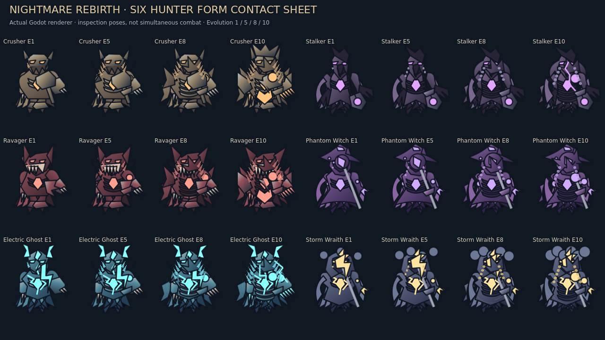
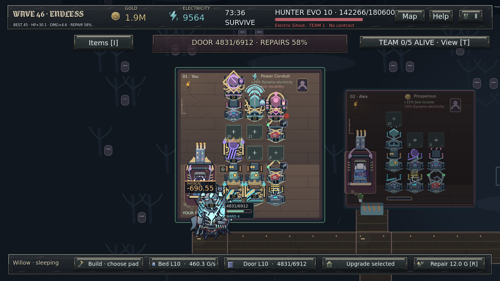

# Phase 8 visual baseline — 6971a18

Reviewed the genuine [Phase7 index](evidence/nightmare-rebirth/INDEX.md), including
four-tier contact sheet, L10/170-cell building galleries, Storm signature release,
Blood Moon combat, dense46 and sampled rebirth sequence.

- [Hunter forms](evidence/nightmare-rebirth/after/hunter-forms-contact-sheet.png):
  angular repeated torso/shoulder vocabulary; tier changes depend too much on spikes.
- [Buildings](evidence/nightmare-rebirth/after/buildings-all-L10.png): repeated
  gold cages and small cores compete with role-specific features.
- [Dense46](evidence/nightmare-rebirth/after/advanced-wave46-live-combat.png):
  ornaments cross other pads; top status repeats urgent information.
- [Storm release](evidence/nightmare-rebirth/after/skill-storm-E10-release.png):
  several rings obscure the creature and do not distinguish individual skills well.
- [Blood Moon](evidence/nightmare-rebirth/omen-runtime/screens/B-blood-moon-combat.png):
  readable, but moon and atmosphere feel detached from architecture.
- [Sampled reveal](evidence/nightmare-rebirth/video/rebirth-frame-sequence.mp4)
  proves poses only, not fluid real-time movement.

These are implementation-owner visual observations, not a human audience survey.
Phase8 must prove improvement with actual engine output and continuous capture.
A fresh baseline400-frame dense-combat benchmark was recorded before production
edits under the same Linux/Mesa software renderer as the new benchmark.

## Genuine visual references

[Matched fully occupied16-slot baseline renderer](evidence/cinematic-nightmare/after/full16-before.png) uses preserved baseline art code on the same actual paid state as the new comparison, with the current HUD. It is an engine render, not an image composite.
