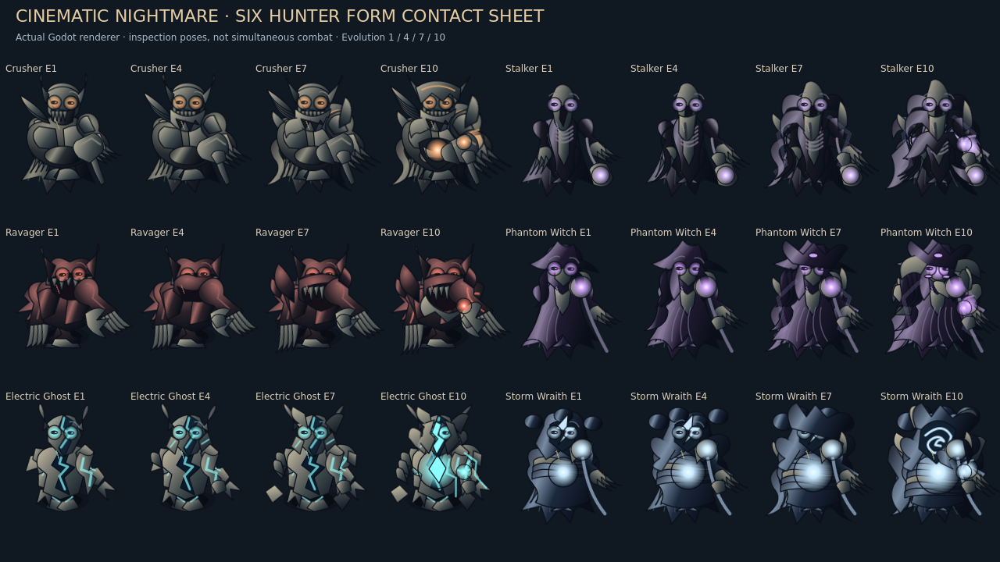

# Cinematic Nightmare — real Godot evidence

Godot4.6.3, Linux/Mesa software rendering. PNGs are actual engine output. Galleries/closeups use the production renderer, explicitly **inspection**, not simultaneous enemies or buildings in a match. Prepared levels/wallets/contact/cooldowns and campaign threshold states are controlled scenarios, not human playtests or natural progression. The earned45→46 continuation is separately identified.

## Start here

- [Continuous actual gameplay movie](video/continuous-combat.mp4), normal wall-time playback,1280×720,≈24 encoded fps. **Silent X11 capture**; [actual engine Master mix](after/continuous-combat-master.wav) is separate because Dummy audio and screen capture clocks differ. No fabricated synchronized soundtrack.
- [Final video metadata](video/probe.json) and [per-scene wall time/simulation/casts](continuous-timeline.json). Five evolved skills and Storm signature/rebirth occur in the movie; all six signatures have screenshots below.
- [Six-role four-tier contact sheet](after/hunter-forms-contact-sheet.png), [1080p](after/hunter-forms-contact-sheet-1080.png), [monochrome silhouette inspection](after/hunter-silhouette-inspection.png).
- [Full16 before](after/full16-before.png) → [Full16 after](after/full16-after.png), same actual purchased state/camera, frozen earned45 intermission. Baseline renderer with current HUD, not image editing. [Actual wave46 combat720p](after/full16-combat-720.png) / [1080p](after/full16-combat-1080.png).

## A / B — all six archetypes, four milestones and closeups

Hunter | E1 | E4 | E7 | E10 | Closeup E1/E10
---|---|---|---|---|---
crusher | [1](after/crusher-E1.png) | [4](after/crusher-E4.png) | [7](after/crusher-E7.png) | [10](after/crusher-E10.png) | [comparison](after/closeup-crusher.png)
stalker | [1](after/stalker-E1.png) | [4](after/stalker-E4.png) | [7](after/stalker-E7.png) | [10](after/stalker-E10.png) | [comparison](after/closeup-stalker.png)
ravager | [1](after/ravager-E1.png) | [4](after/ravager-E4.png) | [7](after/ravager-E7.png) | [10](after/ravager-E10.png) | [comparison](after/closeup-ravager.png)
witch | [1](after/witch-E1.png) | [4](after/witch-E4.png) | [7](after/witch-E7.png) | [10](after/witch-E10.png) | [comparison](after/closeup-witch.png)
electric | [1](after/electric-E1.png) | [4](after/electric-E4.png) | [7](after/electric-E7.png) | [10](after/electric-E10.png) | [comparison](after/closeup-electric.png)
storm | [1](after/storm-E1.png) | [4](after/storm-E4.png) | [7](after/storm-E7.png) | [10](after/storm-E10.png) | [comparison](after/closeup-storm.png)

## C / D — transformation and all twelve actual skills

[Rebirth frame06](after/rebirth-06.png) · [frame00](after/rebirth-00.png) · [frame12](after/rebirth-12.png) · [actual true-form defeat](after/true-form-defeat.png). The uncut movie's final Storm segment shows continuous motion; numbered PNGs are supplementary time-sampled frames, not a substitute for video.

Hunter | Evolved warning / release / aftermath | Signature warning / release / aftermath
---|---|---
crusher | [warning](after/skill-crusher-E4-warning.png) / [release](after/skill-crusher-E4-release.png) / [aftermath](after/skill-crusher-E4-aftermath.png) | [warning](after/skill-crusher-E10-warning.png) / [release](after/skill-crusher-E10-release.png) / [aftermath](after/skill-crusher-E10-aftermath.png)
stalker | [warning](after/skill-stalker-E4-warning.png) / [release](after/skill-stalker-E4-release.png) / [aftermath](after/skill-stalker-E4-aftermath.png) | [warning](after/skill-stalker-E10-warning.png) / [release](after/skill-stalker-E10-release.png) / [aftermath](after/skill-stalker-E10-aftermath.png)
ravager | [warning](after/skill-ravager-E4-warning.png) / [release](after/skill-ravager-E4-release.png) / [aftermath](after/skill-ravager-E4-aftermath.png) | [warning](after/skill-ravager-E10-warning.png) / [release](after/skill-ravager-E10-release.png) / [aftermath](after/skill-ravager-E10-aftermath.png)
witch | [warning](after/skill-witch-E4-warning.png) / [release](after/skill-witch-E4-release.png) / [aftermath](after/skill-witch-E4-aftermath.png) | [warning](after/skill-witch-E10-warning.png) / [release](after/skill-witch-E10-release.png) / [aftermath](after/skill-witch-E10-aftermath.png)
electric | [warning](after/skill-electric-E4-warning.png) / [release](after/skill-electric-E4-release.png) / [aftermath](after/skill-electric-E4-aftermath.png) | [warning](after/skill-electric-E10-warning.png) / [release](after/skill-electric-E10-release.png) / [aftermath](after/skill-electric-E10-aftermath.png)
storm | [warning](after/skill-storm-E4-warning.png) / [release](after/skill-storm-E4-release.png) / [aftermath](after/skill-storm-E4-aftermath.png) | [warning](after/skill-storm-E10-warning.png) / [release](after/skill-storm-E10-release.png) / [aftermath](after/skill-storm-E10-aftermath.png)

Original magical kits remain: [Witch projectile](after/original-witch-impact.png), [Electric interference](after/original-electric-impact.png), [Storm lightning](after/original-storm-impact.png).

## E / F — all buildings and every-level construction

[All17 L1](after/buildings-all-L1.png) · [L5](after/buildings-all-L5.png) · [L10](after/buildings-all-L10.png) · [170 appearances at1080p](after/all-seventeen-all-ten-levels-1080.png) · [representative1–10 closeup](after/progression-closeup-1-10.png) · [real paid L10 upgrade](after/paid-L10-upgrade-reveal.png).

These use real production art, not a fictional room with170 buildings. Purchase/cap behavior is a separate real-model fixture with declared temporary funds.

## G / H / I — dense room and combat

[Before full16](after/full16-before.png) · [after full16](after/full16-after.png) · [selected inspection](after/full16-selected-inspection.png) · [mixed7–10](after/full16-mixed-7-10.png) · [live720p](after/full16-combat-720.png) · [live1080p](after/full16-combat-1080.png).

Full16 uses existing earned funds and genuine paid upgrades. Mixed7–10 explicitly poses lower presentation levels for density inspection. Live combat uses controlled contact/time from the genuine checkpoint; it is not a fresh human run. Separately, [earned-wave46.json](earned-wave46.json) records a full-health Hell victory with unchanged rules, using original funds, real upgrades and ordinary fixed-step simulation. Its42.8s win completed no evolved cast; prepared skill scenarios prove those mechanics separately.

## J — accepted Night Omens and decline

[Blood Moon](omen-runtime/screens/B-blood-moon-combat.png) · [Blackout](omen-runtime/screens/C-blackout-combat.png) · [Cursed Walls](omen-runtime/screens/D-cursed-walls-combat.png) · [declined](omen-runtime/screens/F-declined-combat.png) · [actual reward](omen-runtime/screens/E-completed-reward.png) · [intermission720](omen-runtime/screens/A-intermission-720.png) / [1080](omen-runtime/screens/A-intermission-1080.png).

Actual intermission selection and wave flow; temporary starting budget and low initial Hunter HP reach intermission. Not a natural full playthrough. Omen mechanics remain unchanged.

## K — settings / lower intensity

[Settings](after/quality-settings.png) · [actual X11 input and saved preferences](after/quality-settings-input-verified.png) · [Low](after/quality-low.png) · [Medium](after/quality-medium.png) · [High](after/quality-high.png) · [motion/flash reduction](after/quality-accessible.png).

## L — continuous motion and engine audio

[Uncut movie](video/continuous-combat.mp4) · [Master overlap WAV](after/continuous-combat-master.wav) · [isolated real rebirth event](after/rebirth-master.wav) · [defeat event](after/true-form-defeat-master.wav) · [audio metrics](audio-metrics.json). No subjective audition or native Windows claim. Video thumbnails are decoded actual frames, not composites: [movement](video/frame-2.png), [combat](video/frame-32.png), [transformation](video/frame-66.png).

## Baseline / testing / reproducibility

[Original Phase7 Hunter sheet](../nightmare-rebirth/after/hunter-forms-contact-sheet.png) · [old building sheet](../nightmare-rebirth/after/buildings-all-L10.png) · [old dense46](../nightmare-rebirth/after/advanced-wave46-live-combat.png) · [fresh baseline performance](before/performance.json) / [updated paired performance](performance.json) · [full16 sample](full16-performance.json) · [early/six-role samples](profiles-performance.json).

[Effective final test results](tests/effective-final-results.json) · [initial results including failures](tests/first-results.json) · [fixed reruns](tests/final-results.json) · [final capture results](delivery-capture-results.json) · [fixtures](fixtures/). Developer fixtures require isolated profiles and local output-path adjustment. Production capture/authoring tools are in the repository tools directory. Actual canonical source and user saves are never overwritten. SHA256 manifest covers packaged evidence.

Readable log files normalize terminal carriage returns/trailing whitespace; exact original bytes are retained beside changed logs as `.log.raw.gz`. No assertions or outcomes are removed.
