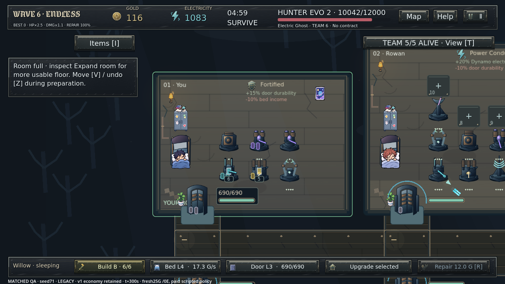
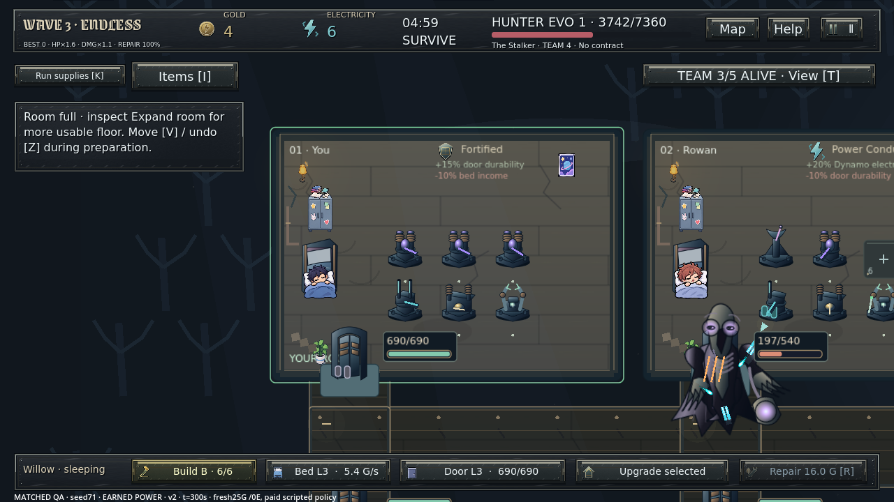
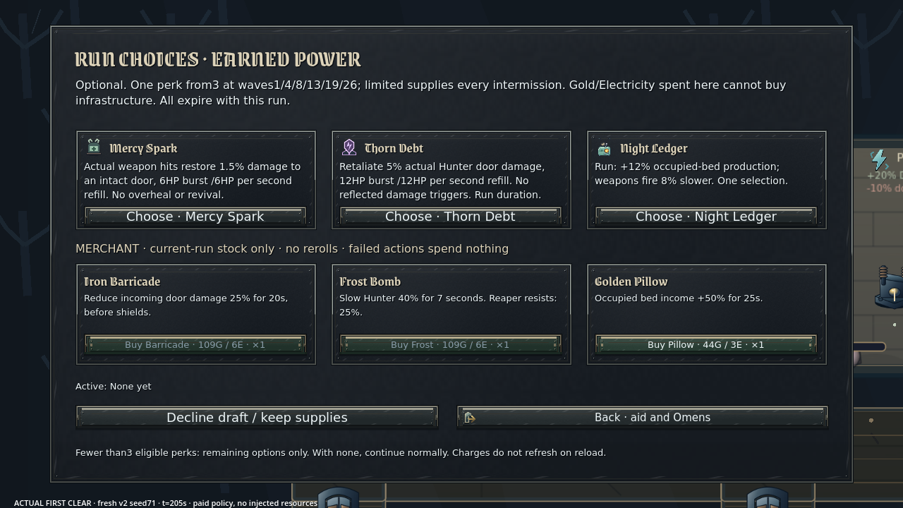
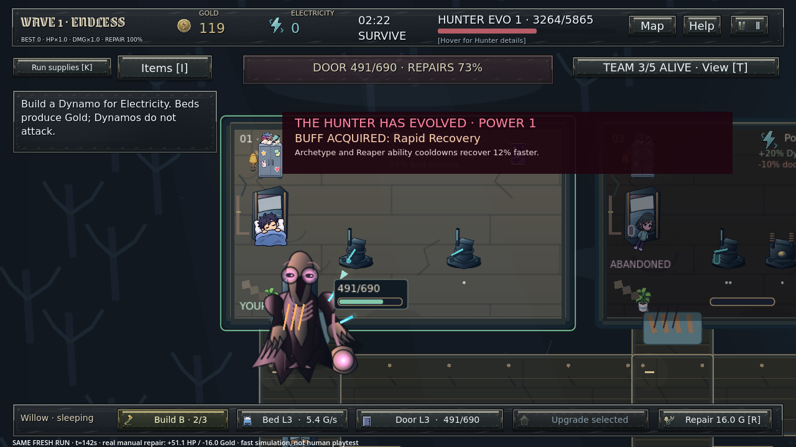

# Phase 12 — actual runtime evidence

All PNGs are genuine Godot4.6.3 Linux/Xorg/Mesa frames. No generated gameplay or mockups. Prepared versus earned states are distinguished below. No native Windows or human-playtest claim.

## Matched fresh progression

Same seed71,25G/0E, no permanent items/perks, automatic room claim/sleep at t0, one paid policy decision/second, frozen rendered frames after accelerated actual-model ticks. Legacy v1 and new v2 use the current renderer. Same strategy intent; v2 saves for power under changed prices.

| Simulation time | Legacy rules | Earned Power v2 |
|---|---|---|
|0s|[Before](screens/before-fresh-0.png)|[After](screens/after-fresh-0.png)|
|60s|[Before](screens/before-fresh-60.png)|[After](screens/after-fresh-60.png)|
|180s|[Before](screens/before-fresh-180.png)|[After](screens/after-fresh-180.png)|
|300s|[Before](screens/before-fresh-300.png)|[After](screens/after-fresh-300.png)|

Legacy at five minutes:

New at five minutes:

## Choices and actual interaction

- [Fresh earned economy/defense purchase decision](screens/new-economy-decision.png)
- [First actual wave clear/intermission](screens/intermission-v2.png)
- [Three eligible perks and three merchant offers720p](screens/perk-and-merchant-720.png)
- [Same choices1080p](screens/perk-and-merchant-1080.png)
- [Chosen perk](screens/perk-selected.png)
- [Actual first draft frame extracted from continuous recording](screens/live-first-draft.png)
- [Real six-minute journey: first Dynamo](screens/live-earned-dynamo.png)
- [Real journey: economy flow report](screens/live-economy-flow.png)
- [Real journey: merchant purchase](screens/live-merchant-purchase.png)
- [Real journey: final position](screens/live-six-minute-position.png)

## Actual pressure and counter

Fresh Hell seed1, paid defensive strategy, no assigned money/HP/Hunter position. These are accelerated actual-model simulation frames, not normal-speed input footage. A16G repair restores51.1HP under genuine siege at142.2s. [Numerical receipt](../earned-power/pressure-counter.json).

## Crowded UI stress

**Prepared paid stress fixture:**1M test budget, all16 machines upgraded through actual purchase APIs, Bed/Door10. Never presented as earned fresh progression. Team0/0 is accurate before bots have claimed rooms at t0 in this fixture.

- [Full16 at720p](screens/crowded-16-720.png)
- [Full16 at1080p](screens/crowded-16-1080.png)
- [Active-perk summary/supplies](screens/active-perks-supplies.png)

## Continuous video and separate audio

- [362.96s MP4,1280×720/24fps, silent](video/continuous-scripted-input.mp4)
- [355.08s actual internal Master FLAC](video/master.flac)
- [Actions/checks/flows/bounded trace](live-journey.json)
- [Capture conditions](video/capture-metadata.json)
- [Engine log:86 checks,zero failures](video/engine.log)
- [Audio RMS/peak/segment metrics](video/audio-metrics.json)

Scripted InputEvents at normal gameplay speed. Fresh profile, existing practice Skip, no wallet/HP/position/stat injection, actual purchases, first perk/shop purchase, save/exit/resume and further waves. Final script journey360.69 wall seconds/329.84 simulation seconds/3clears. Video encoder clock includes a short setup/tail. Audio is separate, not synchronized or claimed as microphone/Windows playback. Internal signal is measured, subjective sound is unverified. Recording predates the final wording/K-button clipping correction and legal late-Pillow save-validation boundary fix; core economy and combat numbers are unchanged.

## Numerical and test evidence

- [Original baseline static audit](baseline-static-audit.json), [120 baseline cases](baseline-strategies.json)
- [Greedy40](new-greedy.json), [defense40](new-defense.json), [balanced40](new-balanced.json)
- [All distributions](progression-summary.json), [final actual balance tables](final-balance-tables.json)
- [Grid-first legitimate machine10 reachability](grid-first.json)
- [Long Night supplemental30](long-night.json), [compatible permanent pair6](permanent-pair.json)
- [Tuned Hell counter10](hell-counter-tuned.json), [prepared limited saved supplies10](hell-supplies.json), [alternative Hell siege10](hell-siege.json)
- [First/last draft-path combat measurements6](combat-reward-paths.json)
- [Strongest prepared combination](strongest-combination.json)
- [140 existing regression resolution](regressions/resolved.json), [final focused checks](final-focused.json)

Failed initial experiments and initial regression logs are deliberately retained. Strategy defeat is a measured outcome, not disguised as a passing balance test. Historical output regenerated by tests is archived under `historical-reruns/`; the canonical earlier evidence remains unchanged.
