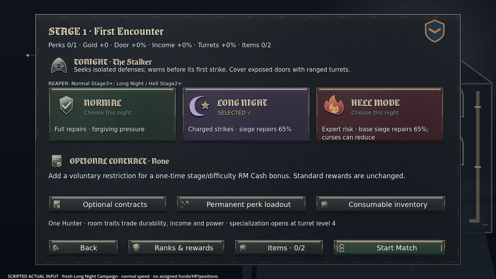
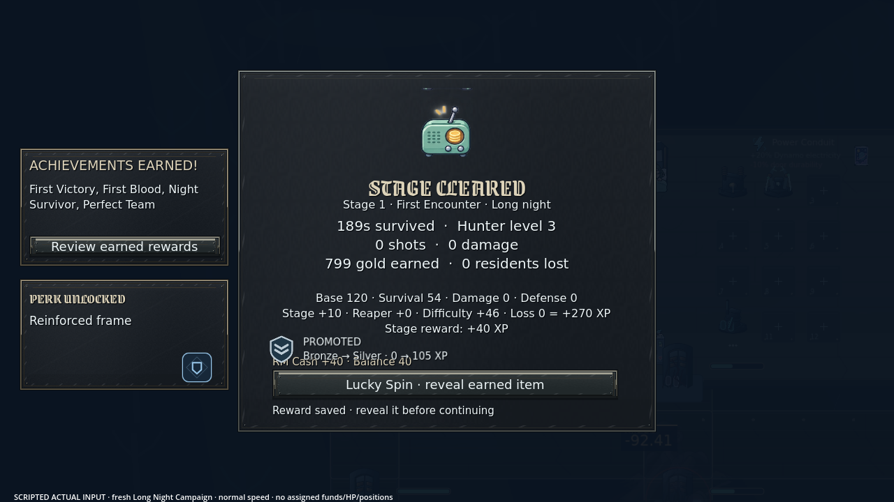
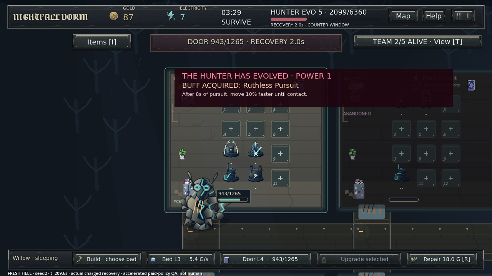
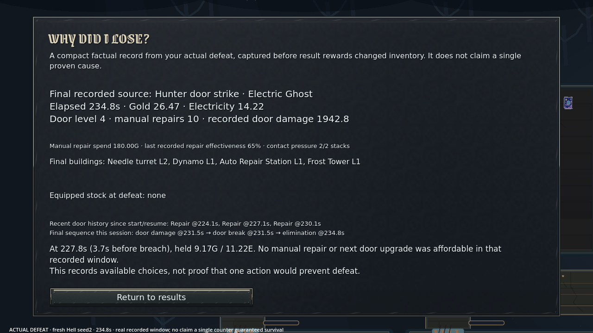
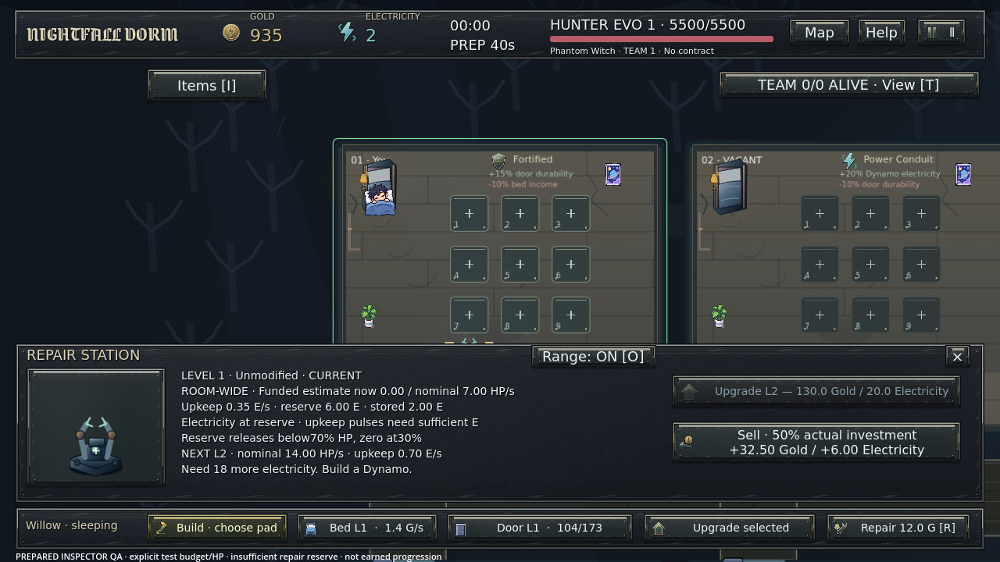

# Phase 12B — actual evidence

Real Godot4.6.3 Linux/Xorg/Mesa output. No generated gameplay/mockups. Native Windows and human playtesting remain unverified.

## Normal-speed victory

- [Continuous204.42s MP4,1280×720/24fps, silent](video/continuous-scripted-input.mp4)
- [Separate190.125s actual Master FLAC, not synchronized](video/master.flac)
- [Real input journey and transactions](live-journey.json)
- [Engine log:41 checks/zero failures](video/engine.log)
- [Capture conditions](video/capture-metadata.json), [video metrics](video/video-metrics.json), [audio metrics](video/audio-metrics.json)

Fresh profile; normal menu-selected Long Night Stage1/Stalker, walking/claim/sleep, keyboard/mouse purchases/upgrades/repairs and real final victory. No assigned money/HP/position, manual kill, time acceleration or item/permanent-bonus grants. Actual victory189.28sim seconds/202.57wall seconds. JSON40 gameplay assertions precedes final audio assertion, hence engine41. Legitimate post-victory inventory is not an activation bypass. This is scripted InputEvents, not human play. Video predates only the final compact repair-copy/recovery-priority UI corrections; final numeric rules/range-aware bots were loaded.

## Final current-rule runtime frames

Below: fresh Hell seed2/Bulwark,25G/0E, no items/perks, automatic claim/sleep at0 and actual paid model policy one decision/s. Accelerated simulation with frozen real rendered frames, **not** normal-speed video or human input. It ultimately loses; a paid repair is not labelled a whole-run win.

- [Same recovery1080p](screens/recovery-seed2-1080.png)
- [Before actual paid response](screens/counter-seed2-before.png)
- [After actual paid response](screens/counter-seed2-after.png)

- [Actual factual defeat1080p](screens/defeat-analysis-1080.png)
- [Fresh Hell seed1 actual model-policy victory](screens/hell-victory-720.png)
- [Model/render receipt](render-scenarios.json), [render log14/0](render.log)

## Inspector funding fixture

Explicit prepared budget/HP, real paid station,2E stored versus6E protected at60% door HP. This is UI funding QA, not earned progression. It correctly shows zero funded output and the actual next-level quote. No stale/clipped next-tier copy is presented as final.

Older iterations are retained separately under `screens-prior-iterations/`; they are not final screenshots. A failed initial sleep setup and a prior genuine victory with an incorrect post-reward inventory assertion have labelled retained logs/receipts, not passing-final claims.

## Full denominators and reproduction

- [Complete248 outcome rows](outcomes.csv), [distributions and archetype outcomes](summary.json), [summary log](summary.log)
- [Original production-source archive receipt](original-source-receipt.json)
- Original same-policy baseline: [Long Night Bulwark](before-disciplined-hard-bulwark.json), [Long Night Assault](before-disciplined-hard-assault.json), [Hell Bulwark](before-disciplined-hell-bulwark.json), [Hell Assault](before-disciplined-hell-assault.json)
- Final: [Long Night Bulwark20/20](after-hard-bulwark.json), [Long Night Assault20/20](after-hard-assault.json), [Hell Bulwark11/20](after-hell-bulwark.json), [Hell Assault14/20](after-hell-assault.json)
- [Normal greedy20](normal-greedy.json), [defense20](normal-defense.json), [balanced20](normal-balanced.json),10min horizon
- [Recoverable mistake3](recoverable-mistake.json)
- Passive Hell: [original5](passive-hell.json), [held-out15](passive-hell-heldout.json); passive Long Night[5](passive-hard.json)
- [Independent audit](independent-audit.md), [independent frozen-checkpoint QA](independent-qa/QA.md), [final focused checks](final-focused.json), [full140 regressions](regressions/regular.json)

All old failures and staged/controlled comparisons remain in this directory. No test strategy is asserted optimal. Detailed traces are complete for designated seeds1/2; other seeds have complete outcomes/final accounts, not invented per-hit histories. Final report explains the remaining allied-carry/Normal-greed limitations.
