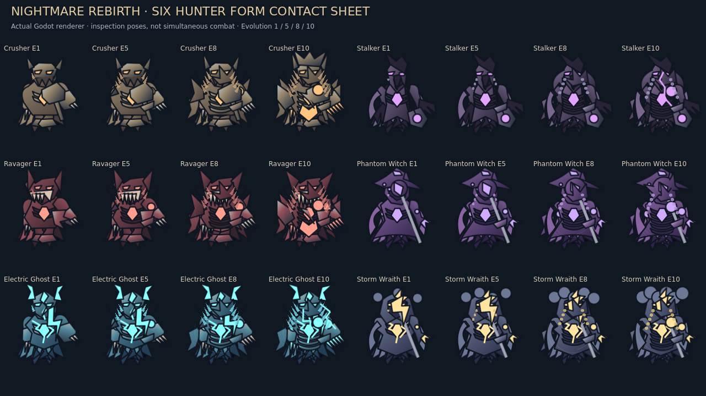

# Nightmare Rebirth — actual Godot evidence

All PNGs are Godot 4.6.3 runtime output, Linux/Mesa. Inspection galleries use the production renderer and are explicitly not simultaneous combat. Portraits and skill fixtures pose isolated state/budgets; they are not natural progression or human playtests. No generated mockups or edited gameplay composites.

## Hunter forms A–D

[1080p sheet](after/hunter-forms-contact-sheet-1080.png) · [Historical renderer inspection](after/hunter-forms-baseline-inspection.png)

Hunter | Original E1 | Awakened E5 | Nightmare E8 | True E10
---|---|---|---|---
crusher | [E1](after/crusher-E1.png) | [E5](after/crusher-E5.png) | [E8](after/crusher-E8.png) | [E10](after/crusher-E10.png)
stalker | [E1](after/stalker-E1.png) | [E5](after/stalker-E5.png) | [E8](after/stalker-E8.png) | [E10](after/stalker-E10.png)
ravager | [E1](after/ravager-E1.png) | [E5](after/ravager-E5.png) | [E8](after/ravager-E8.png) | [E10](after/ravager-E10.png)
witch | [E1](after/witch-E1.png) | [E5](after/witch-E5.png) | [E8](after/witch-E8.png) | [E10](after/witch-E10.png)
electric | [E1](after/electric-E1.png) | [E5](after/electric-E5.png) | [E8](after/electric-E8.png) | [E10](after/electric-E10.png)
storm | [E1](after/storm-E1.png) | [E5](after/storm-E5.png) | [E8](after/storm-E8.png) | [E10](after/storm-E10.png)

## Skills E–J

Each release follows real simulation effects in an isolated campaign sandbox. Warnings and impacts are separate captures, not a collage. Original magical abilities also remain captured below.

Hunter | Evolved warning / release | Signature warning / release
---|---|---
crusher | [warning](after/skill-crusher-E4-warning.png) / [release](after/skill-crusher-E4-release.png) | [warning](after/skill-crusher-E10-warning.png) / [release](after/skill-crusher-E10-release.png)
stalker | [warning](after/skill-stalker-E4-warning.png) / [release](after/skill-stalker-E4-release.png) | [warning](after/skill-stalker-E10-warning.png) / [release](after/skill-stalker-E10-release.png)
ravager | [warning](after/skill-ravager-E4-warning.png) / [release](after/skill-ravager-E4-release.png) | [warning](after/skill-ravager-E10-warning.png) / [release](after/skill-ravager-E10-release.png)
witch | [warning](after/skill-witch-E4-warning.png) / [release](after/skill-witch-E4-release.png) | [warning](after/skill-witch-E10-warning.png) / [release](after/skill-witch-E10-release.png)
electric | [warning](after/skill-electric-E4-warning.png) / [release](after/skill-electric-E4-release.png) | [warning](after/skill-electric-E10-warning.png) / [release](after/skill-electric-E10-release.png)
storm | [warning](after/skill-storm-E4-warning.png) / [release](after/skill-storm-E4-release.png) | [warning](after/skill-storm-E10-warning.png) / [release](after/skill-storm-E10-release.png)

Original witch: [warning](after/original-witch-warning.png) / [impact](after/original-witch-impact.png).

Original electric: [warning](after/original-electric-warning.png) / [impact](after/original-electric-impact.png).

Original storm: [warning](after/original-storm-warning.png) / [impact](after/original-storm-impact.png).

## Transformation, animation and audio K

[Rebirth sampled-frame MP4](video/rebirth-frame-sequence.mp4) · [Locomotion sampled-frame MP4](video/locomotion-frame-sequence.mp4) · [Rebirth GIF](video/rebirth-frame-sequence.gif).
These encode actual time-sampled engine frames; they are not continuous real-time recordings or interpolated animation.

[Defensive reaction](after/state-defensive-reaction.png) · [Hurt](after/state-hurt-reaction.png) · [Collapse](after/state-death-collapse.png) · [True-form defeat](after/true-form-defeat.png).

Actual engine Master capture: [rebirth](after/rebirth-master.wav), [defeat](after/true-form-defeat-master.wav). Nonzero measured output; subjective listening unverified.

## Buildings L–P

[All 17 L1](after/buildings-all-L1.png) · [All 17 L5](after/buildings-all-L5.png) · [All 17 L10](after/buildings-all-L10.png) · [All 170 level appearances at 1080p](after/all-seventeen-all-ten-levels-1080.png) · [Every-level closeups](after/progression-closeup-1-10.png).
These are production-renderer inspection galleries, not buildings placed together in a match.

[Actual paid L10 upgrade reveal](after/paid-L10-upgrade-reveal.png), controlled funded fixture with real purchase accounting.

## Actual accepted Omens Q–S

[Intermission 720p](omen-runtime/screens/A-intermission-720.png) · [1080p](omen-runtime/screens/A-intermission-1080.png) · [Blood Moon combat](omen-runtime/screens/B-blood-moon-combat.png) · [Blackout combat](omen-runtime/screens/C-blackout-combat.png) · [Cursed Walls combat](omen-runtime/screens/D-cursed-walls-combat.png) · [Completion](omen-runtime/screens/E-completed-reward.png) · [Declined](omen-runtime/screens/F-declined-combat.png).
Actual accept/decline and wave flow, with isolated starting budgets/contact and low initial Hunter HP to reach intermission; not a fresh natural playthrough.

## Genuine before/after T

[Baseline Crusher](before/crusher-matched.png) → [Current Crusher](after/crusher-E1.png): equivalent posed camera/state.

[Baseline earned wave45](before/earned-wave45-matched.png) → [Current earned wave45](after/earned-wave45-matched.png): same legitimate checkpoint, not edited funds. TEAM 0/5 correctly records five eliminated allies; their buildings remain. Wave45 is an intermission with a defeated Hunter, not active combat.

[Advanced wave46 live combat](after/advanced-wave46-live-combat.png) is a controlled stress scene. Separately, [earned-wave46.json](earned-wave46.json) records a genuine full-health Hell wave46 victory from the original earned45 checkpoint using actual paid upgrades; no evolved cast completed in that winning run.

## Reproduction and limits

[Fixtures](fixtures/) retain capture setup; [tests](tests/) contains raw gates/import logs. Run tests with isolated NIGHTFALL_PROFILE_PATH and XDG directories, never against user saves. Fixtures refer to original /workspace paths and require local path adjustment. Video source frames remain in after/. [Performance](performance.json) is a 400-frame software-rendered Linux sample, not Windows validation or a long-session benchmark.
