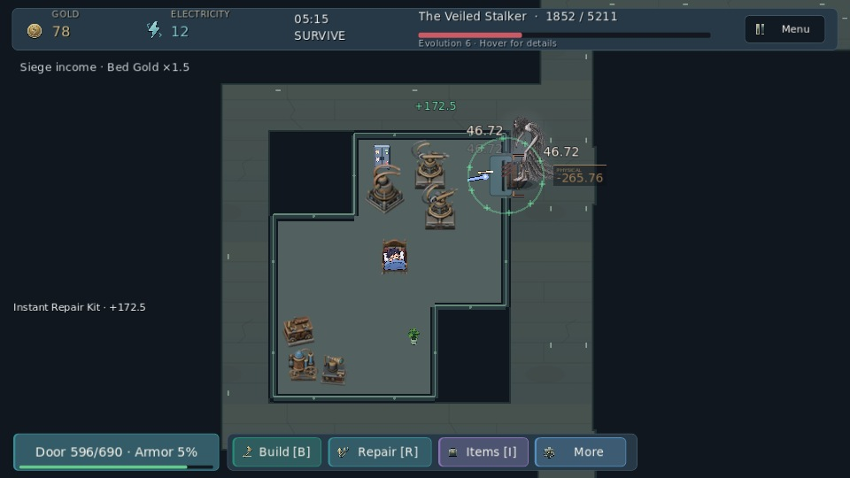

# Phase 23 · Hunter intelligence and fair balance

[Download the Windows x64 playtest](https://github.com/fahim23022003-ai/nightfall-dorm/releases/download/phase23-hunter-intelligence-preview/NightfallDorm-Phase23-Windows-x64.zip) · [Play instructions](../../PHASE23_PLAYTEST.md) · [49-second gameplay recording with audio](walkthrough.mp4)

The ordinary Story Hunter now takes turret coverage along its approach into account. At a door it uses actual landed damage, funded repair and observed recovery to decide whether to finish the siege or switch. A door tier raises maximum HP once and receives credit for that investment. Smoke can redirect an ordinary approach, while Decoy can interrupt an active Haunted Hall recovery. Completing a heal restores eligibility to a room the Hunter was still traveling toward. The existing commitment, two-hit finish, elemental matchups, seeded variation and Reaper telegraphs still govern combat. [Diagnosis and controlled archetype checks](diagnosis.md)

## Did player decisions matter?

Across 420 candidate Story matches on 20 mission maps, a passive player won 2/60. The item-free skilled policy won 41/60, including 8/20 on Hell. Phase 22.1 also gave the skilled policy 41/60 wins on these same fixtures. The two builds produced different individual outcomes.

| Outcome on the 210 held-out cases | Phase 22.1 | Phase 23 |
| --- | ---: | ---: |
| All team victories | 79 | 90 |
| Passive wins (30 attempts) | 0 | 2 |
| Skilled wins on Hell (10 attempts) | 4 | 5 |
| Matches where the Hunter physically reached the player's door | 186 | 179 |
| Return contacts with a previously reached room | 116 | 268 |
| Victories with zero personal Hunter damage and zero damage to the player's door | 15 | 9 |

On the 210 development cases, total wins went from 74 to 73, passive wins from one to zero, and untouched zero-damage wins from one to eight. Across all 420 pairs, the count of physical player-room visits fell from 385 to 373 matches. The release fixes identifiable targeting errors. The evidence does not establish an overall reduction in repeated visits or ally carries. Both final passive victories occurred on the same held-out Level 27 Zigzag map, on Normal and Long Night. Teammates dealt the killing damage while the player's door took some damage at range. No passive Hell run won. Team damage, Hunter HP, damage, prices and reward formulas use their existing rules.

Late Story showed distinct encounter windows, Hall use and boss transitions. Difficulty generally separated the matched skilled policies. The chapter bands did **not** demonstrate a steadily rising difficulty curve. Authored layouts, archetypes and equipment change together. The 840 main matches sampled ten missions across ten chapters at a 0.15s simulation step. Twelve preselected outcomes reproduced at 0.05s, although individual terminal times differed by up to 56.9s. Eight extra early Normal maps tested the slower beginner policy. A second Needle alone raised damage on six maps and did not flip a win or loss. [All seven policies, chapter bands, baseline, held-out and individual traces](cohort-results.md) · [Protocol](cohort-method.md)

## Items and counterplay

In Hard Room 6 on seed 671109, a purchased Battery extended survival from 217.2s to 394.2s and increased the player's applied damage from 3,276 to 5,040. On a different Hard opening the same Battery made no material difference because Electricity was not the constraint. The broader set of 60 skilled comparisons with an earned Gold Crate changed six defeats into victories and one victory into a defeat. All 95 NPC wallets in the separate 19-match item suite reconciled. There was no evidence for an across-the-board NPC damage reduction. [Matched item tests](items.md) · [Footage and event timestamps](film.md)

## Rendering cost

In eight isolated Linux llvmpipe runs, Standard combat p95 was 45.18 ms before and 44.68 ms after. Low median improved from 20.20 to 18.66 ms, while p95 rose from 24.46 to 25.02 ms and p99 rose from 27.99 to 35.99 ms. A controlled six-room, 60-weapon CPU test increased the median full target assessment from 1.67 to 2.49 ms. This work runs when the Hunter chooses or reassesses a door. Rare Low-mode hitches remain a Windows playtest priority. [Conditions, draw counts and raw frames](performance.md)

## Verification and compatibility

Linux Godot 4.6.3 loaded the exported Windows executable's embedded pack, started Story through the 15-second offline lobby, and verified the new and fallback launcher settings. There was no native Windows or Intel UHD run and no human difficulty test. The playable source is `4dcaa926c5c27183515db785eaf66cfd6a9ef6f4`. Phase 23 and the Phase 22.1 launcher read the existing Phase 22.1 preview profile. The Performance launcher retains its own profile. The update introduces no save schema or migration.

The 23 regression suites reported 28,107 assertions plus 120 legacy item-balance matches. Covered systems include door contact, all six ordinary archetypes, both boss forms, repair, procedural persistence, grid saves, Story, lobby, profile settlement and combat feedback. A baseline test looked for obsolete wording in defeat advice. Its replacement checks both affordability flags and the current message. [Regression receipt](regressions.json) · [Low and Standard benchmark results](performance.md) · [Windows package and checksum](windows-package.json)
